<div align="center">
  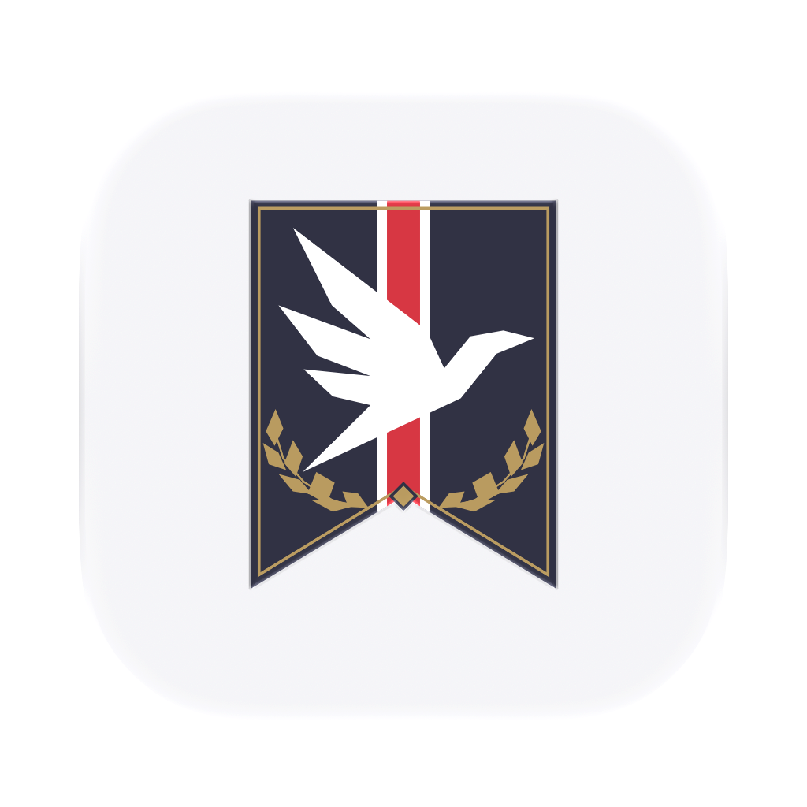
  <h1>Arma</h1>
  <p><strong>An open source browser for Mac, iPhone, and iPad.</strong></p>
  <p>Built with SwiftUI, running Chromium, WebKit and Servo on Mac, with separate Spaces for different parts of your life.</p>
  <p>
    <a href="https://github.com/devops-senpai/BetterCrest/actions/workflows/ci.yml"></a>
    <a href="LICENSE"></a>
  </p>
  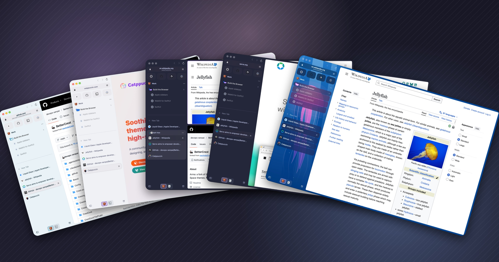
</div>

Arma is a fork of [Crest](https://github.com/pauljoda/Crest) by Paul Davis.
It carries Crest's main branch plus fixes, speedups and features that are
not upstream. Arma is not affiliated with or endorsed by Crest or Paul
Davis. The repository keeps the name BetterCrest; the browser is Arma. The
user guides live in this repository under `HelpCenter/docs/`.

## A quick tour

### Themes

Arma ships with themes for every kind of person: **Arc Sky** for anyone
coming from Arc, **Catppuccin Latte / Mocha** and **Catppuccin Macchiato** for
coders, and **JellyFish**, with its own underwater picture behind the tabs,
for anyone who wants a browser that looks like theirs. Setup offers them
beside the **Heraldic** and **Modern** looks, and Settings › Themes edits every
color, the dark look and the background picture, with a live preview of the
window and its command palette.

| | |
|---|---|
| 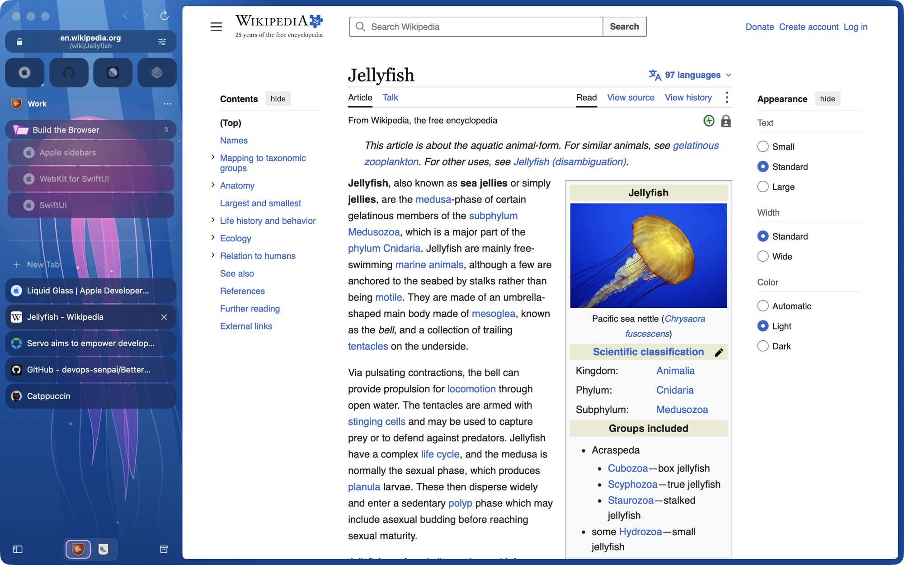 | 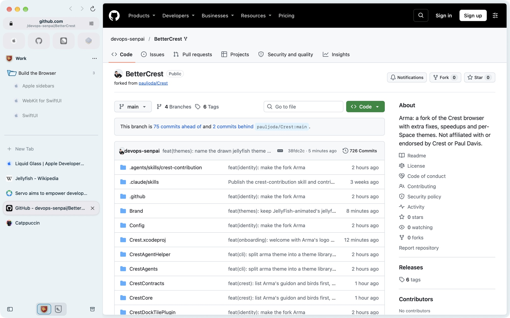 |
| **JellyFish** | **Arc Sky** |
| 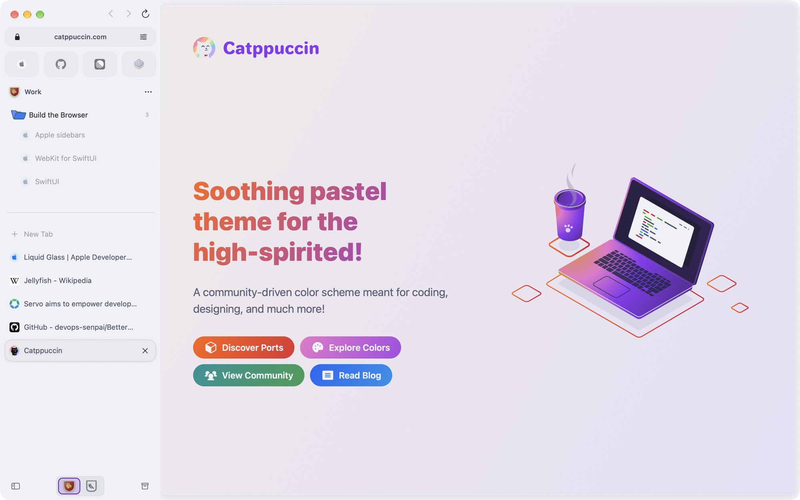 | 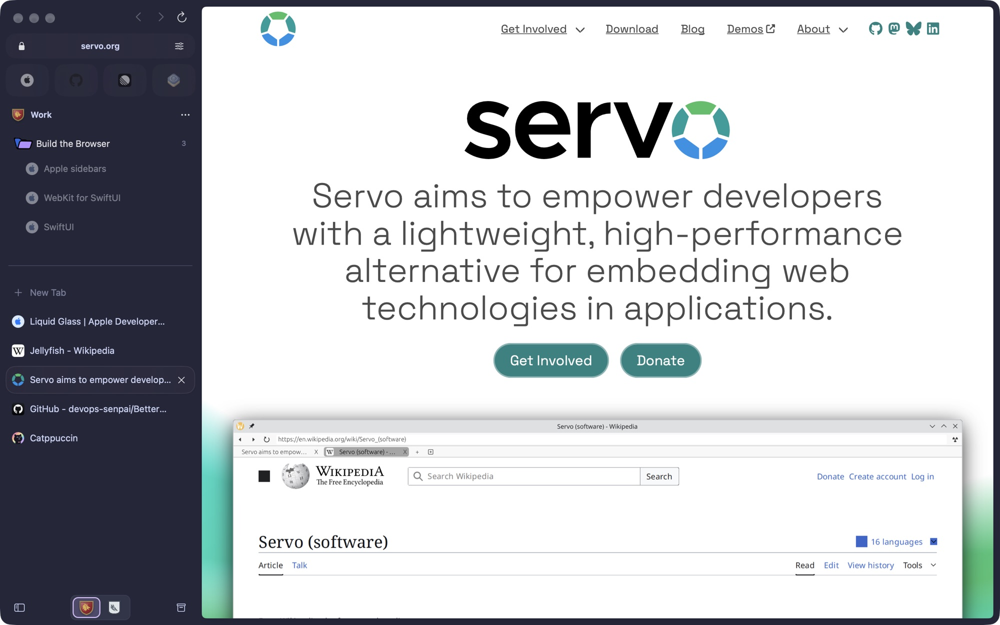 |
| **Catppuccin Latte / Mocha** | **Catppuccin Macchiato** |

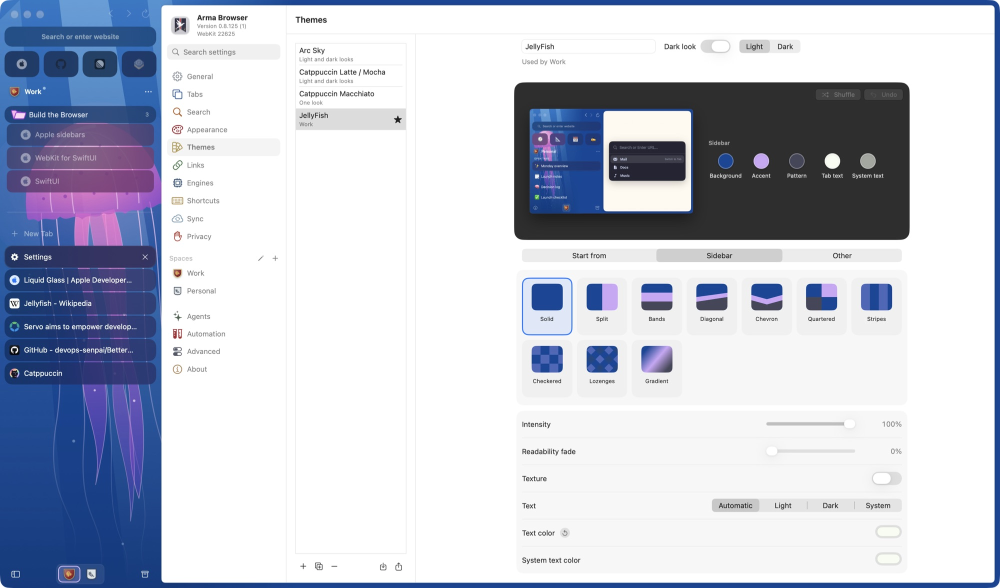

A Space picks its theme; its crest stays its own. The Crest Studio shapes it,
starting from Arma's own **Guidon**, its bird and the Crane.

### Split View, tiled

Keep up to four live pages in one view: side by side, stacked, or in a grid.
Drop a tab on an edge of a page to tile it there, or pick an arrangement from
the split's menu, and drag the bars between pages either way.

| | |
|---|---|
| 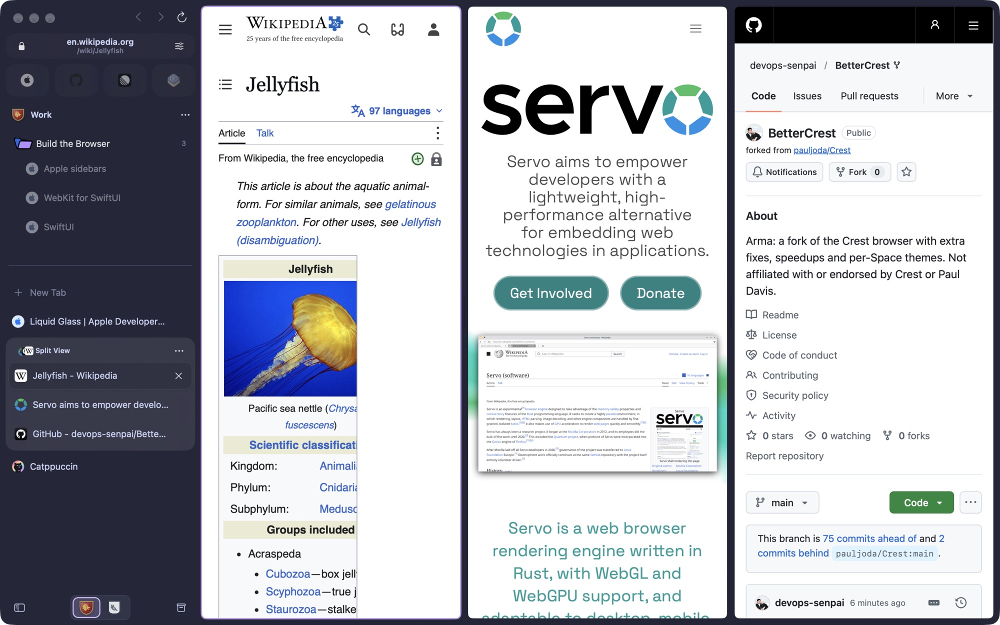 | 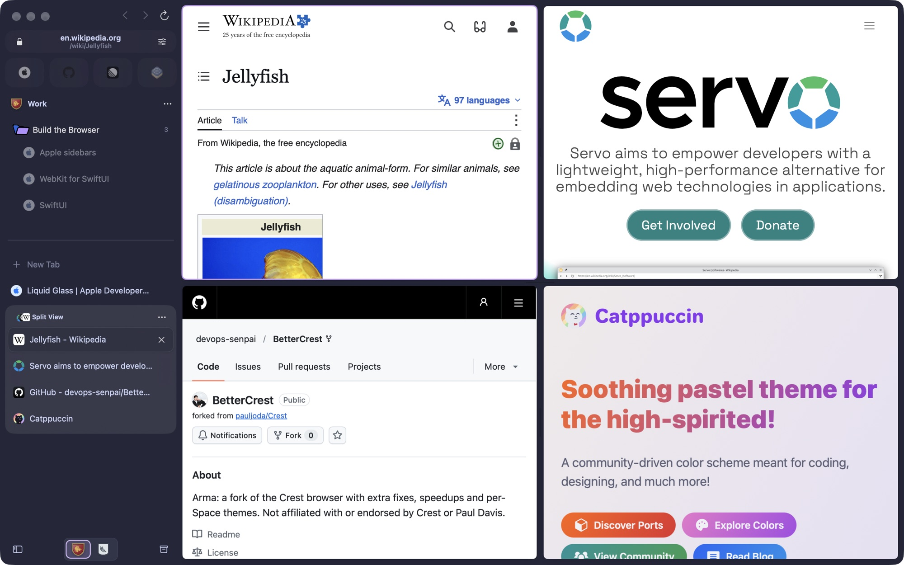 |
| **Three across** | **Four in a grid** |

### Three engines: Chromium, WebKit and Servo

Every page runs in the engine you choose: **Chromium** (the default, with
Chrome Web Store extensions), **WebKit** (Reader, translation, FairPlay video)
or **Servo**, the independent engine written in Rust. Set a default in
Settings › Engines, give a website its own engine, or move one page:

```sh
arma site engine youtube.com webkit          # YouTube always opens in WebKit
arma site engine servo.org servo             # servo.org opens in Servo
arma tab open https://example.com --engine servo
arma tab engine 3f2a chromium                # move one tab's page to Chromium
arma site list                               # every site with its own engine
```

### The `arma` command line

`arma` lives inside the app (`/Applications/Arma.app/Contents/Helpers/arma`)
and drives the running browser. Every command takes `--json` for scripts.

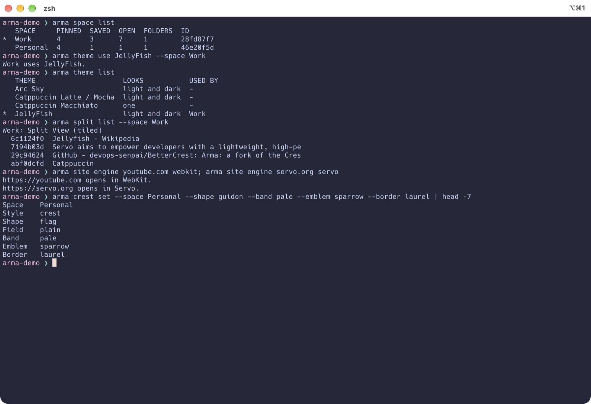

```sh
arma space list                              # Spaces; * marks the one shown
arma space switch Work
arma tab open https://news.ycombinator.com --space Work
arma tab list --space Work                   # ids, placement, folder, engine
arma split create 3f2a 9b1c 77d0             # three tabs in one Split View
arma split arrange 3f2a grid                 # two-across, three-across, grid …
arma theme list                              # saved themes; * the shown Space's
arma theme use JellyFish --space Personal
arma theme edit "Catppuccin Macchiato" --folder-color "#a581ff"
arma crest set --shape guidon --band pale --emblem sparrow --border laurel
arma window tile left
arma settings set appearance.mode dark      
arma page text 3f2a                          # read a page (Settings › Agents)
```

Run `arma help`, or `arma <section> help`, for every section: space, tab,
window, folder, split, command, page, extension, history, download,
settings, site, automation, theme and crest.

### Testing frameworks

Settings › Automation (or `arma automation`) lets Playwright, Puppeteer,
Selenium, WebdriverIO, Katalon and TestCafe drive Arma's Chromium tabs over a
local DevTools port, limited to one Space's profile or an empty Ephemeral one,
and to the tabs they open or existing tabs too. The page shows the setup for
each tool.

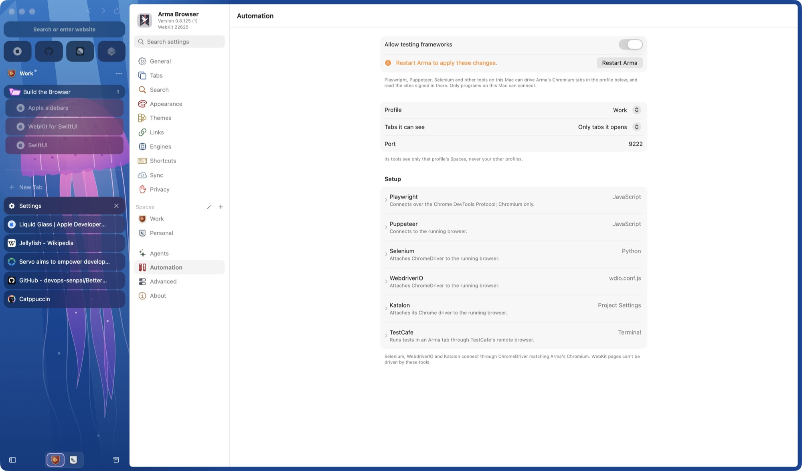

```sh
arma automation on --profile Work --tabs opened --port 9222
arma automation restart
```

```js
// Playwright
import { chromium } from "playwright-core";
const browser = await chromium.connectOverCDP("http://127.0.0.1:9222");
const page = await browser.contexts()[0].newPage();
await page.goto("https://example.com");
```

```js
// Puppeteer
import puppeteer from "puppeteer-core";
const browser = await puppeteer.connect({ browserURL: "http://127.0.0.1:9222", defaultViewport: null });
const page = await browser.newPage();
await page.goto("https://example.com");
await browser.disconnect(); // browser.close() would quit Arma
```

```python
# Selenium, with ChromeDriver matching Arma's Chromium
from selenium import webdriver
options = webdriver.ChromeOptions()
options.debugger_address = "127.0.0.1:9222"
driver = webdriver.Chrome(options=options)
driver.get("https://example.com")
```

## What Arma adds

Everything below is in Arma and not in upstream Crest. Each line is one
change; the commit of the same name has the detail.

### Features

- **Extended theming.** Each Space's Appearance page goes further than upstream: pick the colors of folders and their backs, the sidebar text color, and the command palette's tint, opacity and text color, with a separate look for dark windows. Export a Space's theme as a JSON file and load one back from the page or the Space's menu; four Catppuccin themes ship as examples.
- **Theme CLI tools.** `arma theme` lists, makes, edits, imports, shows and picks saved themes, light and dark looks alike, and `arma crest` shapes and colors a Space's own crest or icon. Changes show in the running app right away, so a theme can be tuned without reopening Settings.
- **Themes in setup.** Arma ships with Arc Sky, Catppuccin Latte / Mocha, Catppuccin Macchiato and JellyFish, whose underwater picture is Arma's own; setup's Pick your look page offers them beside Heraldic and Modern, and the theme picked dresses every Space it makes.
- **Arma's own arms.** The Crest Studio offers the logo's Guidon shape and its bird and the Crane as emblems, first in their galleries, and new Spaces start with the guidon, a pale and the logo's bird in their house colors.
- **Command-line control.** `arma` manages the running browser from the terminal: Spaces, tabs (open in a chosen engine, move, pin, save, rename), windows (move, resize, tile), folders, Split View, any menu command, extensions, history, downloads, settings (get, set, export, import) and site rules, with `--json` for scripts. `arma page` reads and drives a page (text, snapshot, screenshot, click, type, JavaScript) once Settings › Agents › Command-line page control is on.
- **Automation for testing frameworks.** Settings › Automation (or `arma automation`) lets Playwright, Puppeteer, Selenium, WebdriverIO, Katalon and TestCafe drive Arma's Chromium tabs over a local DevTools port, limited to one profile or an empty Ephemeral one, and to the tabs they open or existing tabs too, with copyable setup for each tool.
- **Saved themes.** Settings › Themes keeps a library of themes on this Mac: make, duplicate, rename, delete, import and export them, and edit one's colors, dark look and background image, which updates every Space using it. A Space only picks its theme, at the top of its Appearance page beside its own crest; all theme editing happens under Settings › Themes, and a Space that had a look of its own gets it saved as a theme named for it. Duplicate a theme to vary it for one Space. A Space's crest keeps its own colors whatever theme it wears, and a theme can set a secondary text color for the sidebar's quieter labels, such as New Tab. Type `@themes` in the command palette to switch themes from the keyboard, or use Save Look as Theme, Import Theme and Export Theme.
- **Background images.** The Sidebar step of a Space's or theme's look sets a picture behind the sidebar and window, held to its top-left or bottom-left corner, sized to fill, fit or keep its own size, repeated or not, with sliders for how strongly it shows, how much of the Space's colors lie over it, and how blurred it is. A tab backing lays a translucent, optionally frosted plate behind each row or a panel behind the whole sidebar, in the Space's color or one you pick, so tabs stay legible over a busy picture.
- **Tiled Split View.** Drop a tab on the top or bottom edge of a page to stack it there, on the outer edge of the split to give it the full height or width, or on the middle of a page to swap the two; make quadrants from any of these. The split's menu has ready-made arrangements for two, three and four pages, a tab's menu can pick its card up to move with the pointer (⇧⌘-drag does the same), and the bars between pages drag either way; each window keeps the sizes.
- **Servo engine.** Pages can run on Servo, the independent engine written in Rust, as a third engine beside Chromium and WebKit: pick it as the default engine, set it for a website, or move a page with Open Page in Servo. Install Firefox add-ons whose page scripts and styles Servo can run from Settings › Engines.

### Performance

- Closing, deleting or moving a large selection of tabs finishes without a pause in Spaces with lots of tabs.
- The command palette keeps up as you type in Spaces with lots of tabs.
- Switching to the most recent tab answers right away in Spaces with lots of tabs.
- Keeping a window's recent tabs current checks them against the Space once instead of searching every tab for each.
- Closing and moving tabs stays quick in Spaces with many folders.
- The sidebar stays responsive with many pages loaded: a tab's row looks up only its own page.
- Renaming or navigating a tab no longer checks every open tab's saved icon.
- Following a link in a Space with a long history no longer rebuilds every visited link on the page.
- Opening a tab whose page was unloaded no longer waits for other tabs' states to finish saving.
- Saving device records writes each list through one prepared statement instead of one per row.
- Moving the pointer over pages does less work while no link preview is waiting to appear.
- The blurred page previews behind a locked Space appear sooner.
- Each Mac window brings its pages up to date once per session change instead of repeating the tab icon and password passes.
- The Now Playing widget decodes its artwork once per image instead of on every redraw.
- A page a coding agent watches records each message and request without copying everything it already kept.
- The Space previews on the setup pages ask the core to resolve the draft only when it changes.
- On iPhone and iPad, each open page's state is saved once as the app leaves the foreground instead of twice.

### Security and privacy

- Coding agents reading a page's network requests no longer see sign-in headers a site spells its own way, such as X-CSRFToken, X-Auth-Token or an API key header.
- Importing a password file with an oversized field is refused at once instead of stalling the app.
- Closing a tab a coding agent was watching frees the console messages and network requests kept for it.

### Bug fixes

- The sidebar keeps its rows when the window enters or leaves full screen or changes size while scrolled; a list at its end stays at its end.
- Dragging the window by the empty sidebar strip works every time; a trackpad press there often moved nothing, and a press right after a drag counted as a double-click.
- What's New in Settings lists the newest changes instead of the ones whose names sort last.
- A tab an extension closes during an engine switch stays closed instead of coming back empty.
- New tabs opened from a link, the palette, history or a local document load once instead of twice.
- Clicking a command palette row right after typing opens it, and the arrow keys move the selection once results arrive.
- Switching Spaces in Passwords settings while the previous list was still loading no longer blanks the new list.
- Notifications from background websites and extensions keep appearing after many have been dismissed.
- On iPhone, Undo in Crest Studio steps back one change at a time.
- On iPad, a page's alerts, sign-in prompts and export sheets appear in the window that shows the page.
- On iPad, a site's location request no longer waits forever when Settings opens beside the app.
- On iPad, a closed window lets go of its pages, so its memory comes back and a restored window opens its tabs.

### Repository and tooling

- The patch version is derived from history and each release note is its own file, so branches stop conflicting on every merge.
- `Scripts/sync-upstream.sh` merges upstream Crest in one step and leaves only real code conflicts to a person.
- `Scripts/sync-upstream-engine.sh` mirrors upstream's prebuilt Chromium engine for the current engine key, so the fork never builds Chromium.
- `ROUTING.md` and a `CONTEXT.md` in every folder that groups work tell a contributor or an agent what to read for each kind of change.
- `Documentation/Renaming.md` lists every place a product name lives.
- `Brand/` holds the banner artwork; `Scripts/generate-app-icon-palettes.py` turns one banner into the app icon, its palette variants, picker previews and Dock images.
- The version bump check runs statically, the CI whitespace gate works, and stray files no longer change the engine key.

## A browser with boundaries

Most browsers put every login, tab, and distraction into one long-lived container. Arma begins with **Spaces** instead. Give work, home, research, or a private session its own banner; Arma gives each one its own cookies, website data, history, archive, tabs, credentials, settings, and sync identity.

Switching Spaces changes more than the color of the window. It changes the browsing context.

When several Spaces should share one set of sign-ins, make them **Sub-Spaces**: each keeps its own tabs and look while the group shares cookies, history, passwords, and extensions. [Read the Sub-Spaces guide.](HelpCenter/docs/spaces/sub-spaces.md)

## Three engines on Mac

Arma for Mac opens pages in **Chromium** by default. Its engine is Chromium
with Arma's privacy changes, which keep your browsing, form and account data
away from Google, and runs Chrome Web Store extensions. Any website or page can
open in **WebKit** instead, which adds Reader, whole-page translation, built-in
content blocking, and FairPlay video. Chromium plays Widevine video; Netflix,
Disney+, Max and Prime Video open in WebKit, and a page that needs protected
video Chromium can't play switches to WebKit automatically, respecting any
unsaved-changes prompt before moving it. A page can also run in **Servo**, the
independent engine written in Rust. Choose the default engine and
per-website rules in **Settings → Engines**, or with `arma site engine`. iPhone and iPad use WebKit. The
[engine guide](HelpCenter/docs/browsing/engines.md) lists what each engine
supports.

## Crest Studio and Appearance

**Crest Studio** puts each Space's crest on that Space's own sidebar background. Start from a template, then step through shape, field, band, emblem, border, finish and sidebar, choosing from previews of your own crest. Every part of the crest and the sidebar has its own color, named by what it paints. Use heraldic artwork, emoji, monograms, or a searchable SF Symbols picker, and Shuffle and Undo freely.

**Appearance** lets you dock the sidebar on either edge, go borderless, adjust tab shape and scale, choose a pin layout, and tune tab and address-field colors, or let them follow each Space's accent. Start with a preset, see changes live, and reset individual settings. Choose an app icon palette, folder colors and icons, and a default page zoom from 50% to 300%.

## Browsing features

- **A sidebar with structure.** Pins for everyday sites, saved tabs with a home URL, nested folders for projects, and current tabs for what you are doing now. Select tabs, Split Views, and folders together to organize them in one step.
- **Split View.** Keep two to four live pages in a group. Resize columns on Mac and iPad; move through focused cards on iPhone.
- **Peek.** Preview a link above the current page, then close it or keep it as a tab. On Mac, drag a link into a live Peek. On iPhone and iPad, native link and image menus keep touch actions close by.
- **Quick Window on Mac.** Open a link from another app using the right Space’s signed-in session. Promote it to a regular tab when it deserves to stay. Link Routing sends matching external links to their chosen Space.
- **Shared windows on Mac.** Open another window onto the same Spaces and tabs, with its own selection. Use a disposable Blank Window for temporary tabs with your Space’s signed-in session, or create one by dragging a tab outside the window.
- **Search and commands.** Open a URL, search the web, find tabs and history in your Space, or run a command from one field. Choose custom search engines and optional suggestions. Mac shortcuts can be rebound.
- **Getting Started.** Learn tabs, pins, and folders in an interactive browser tab, with Split View practice on Mac.

## Page tools

| Capability | What it does |
| --- | --- |
| On-device translation | On iPhone, iPad, and WebKit pages, detect a page’s language, translate it, or show the original. On Chromium pages, translate selected text. Optional automatic translation uses downloaded languages. Apple may ask to download additional languages. |
| Reader and page tools | Read supported articles with fewer distractions on WebKit pages, find text, adjust zoom, share links, copy Markdown links, print, and export PDF or web archives where supported. |
| Extensions on Mac | Install Chrome Web Store extensions in each Space. They run on Chromium pages, with popups and tab-specific side panels. [Compatibility varies.](HelpCenter/docs/extensions/compatibility.md) |
| Developer tools on Mac | Preview phone, desktop, and custom viewport sizes; capture pages; open Chromium DevTools or Web Inspector for the page's engine. The toolbar appears on localhost, or on any site with **Shift-Command-I**. |
| Media | Control eligible active media from the sidebar. On Mac, keep supported videos visible with Picture in Picture, including optional automatic PiP. |
| Downloads and uploads | Follow download progress and revisit files in Downloads. Pause and resume Chromium transfers when the server supports recovery. On iPhone and iPad, upload through Photos, camera, or Files. |

## Privacy and sync

**Private Spaces** use temporary website storage and stay out of normal history, restoration, and sync. They can require device authentication and relock when Arma leaves the foreground. **Arma Passwords** keeps origin- and Space-matched credentials in the system Keychain, with authentication for sensitive access.

Site permissions and content blocking are controlled per Space. Built-in ad and tracker blocking covers iPhone, iPad, and WebKit pages; on Chromium pages, install a blocking extension. Closed and cleaned-up tabs go to a recoverable Archive, subject to your retention settings. **Keep Loaded** protects a page from ordinary unloading when its live state matters.

Optional **iCloud sync** carries durable Spaces, tabs, folders, Split View groups, appearance, history, and Archive between devices. Password values stay out of CloudKit; eligible passwords can use iCloud Keychain separately. Start a browser import on Mac, review each destination Space, or export a portable archive.

Read the [Space isolation guide](HelpCenter/docs/spaces/spaces-and-isolation.md) and [sync guide](HelpCenter/docs/spaces/sync-across-devices.md) for the boundaries and controls. _Placeholder: Arma has no published privacy policy yet._

## Get Arma

_Placeholder: no screenshots of Arma yet._

Arma has no signed releases yet. Build it from source as described
below; the Mac app runs Chromium when a prebuilt engine is packaged in, and
WebKit alone otherwise.

## Built as an Apple-platform app

Arma's browser state and rules live in a portable core written in C# and compiled with NativeAOT. The apps are written in Swift and SwiftUI: shared features live in `CrestShared`, and each platform owns its windows, engine hosting, commands, and adaptive presentation. On Mac, pages render in Chromium by default or in WebKit; iPhone and iPad use WebKit.

```text
CrestCore/       Portable core: session, sync, pages, and browser rules
CrestContracts/  C ABI header and ABI checks for the core library
CrestEngines/    Chromium host overlay, patches, and engine binding
CrestShared/     Domain, application, infrastructure, features, design system
CrestMac/        macOS app and platform-specific presentation
CrestMobile/     iPhone and iPad app and platform-specific presentation
```

Read [the architecture overview](Documentation/ARCHITECTURE.md) for Space isolation, persistence, credentials, synchronization, and the engine boundary.

## Build Arma

Requirements:

- Apple silicon Mac
- Xcode with macOS and iOS SDKs supporting the 26.1 deployment targets
- [XcodeGen](https://github.com/yonaskolb/XcodeGen)
- .NET SDK pinned by `CrestCore/global.json`, installable with `Scripts/control-plane/install-dotnet.sh`

```bash
git clone https://github.com/devops-senpai/BetterCrest.git
cd Arma
Scripts/bootstrap.sh
open Crest.xcodeproj
```

Xcode builds and embeds the self-contained .NET core for Mac, iOS, and Simulator. Its intermediate files stay in Derived Data; the installed app does not require a .NET runtime. The `Crest` scheme builds the Mac app with WebKit only; a Chromium build adds a prebuilt engine, described in the [Chromium engine README](CrestEngines/Chromium/README.md). See the [control-plane build workflow](Documentation/Architecture/ControlPlane.md#build-workflow) for isolated review builds and Chromium packaging.

`project.yml` is the source of truth for targets and build settings. Run `xcodegen generate` after changing source roots, targets, or project configuration.

## Validate a change

```bash
Scripts/validate-identity.sh
Scripts/validate.sh
Scripts/validate-cache-hygiene.sh
```

Run the relevant behavioral tests and repository checks. Review visual, layout, and static-copy changes in the real app, Simulator, or browser.

## Relationship to Crest

Arma tracks Crest's `main` and merges it in regularly; its own
changes stay here. Use
[GitHub Issues](https://github.com/devops-senpai/BetterCrest/issues) for bugs.

## AI usage

AI tools assist with Arma's development, audits, testing and
documentation. Every generated change is reviewed and validated before it is
committed. Any change an AI tool helps produce follows the
[`crest-contribution` skill](.agents/skills/crest-contribution/SKILL.md), which
carries the C# and Swift style, the architecture and UI rules, and the test
policy.

## License and brand

Arma's source code is available under the [Mozilla Public License 2.0](LICENSE),
as Crest's is. The source is open for inspection, modification, and commercial
use under that license. The Crest name, app icon, logos, and official
distribution identity belong to Paul Davis and are reserved as described in
[TRADEMARKS.md](TRADEMARKS.md). Arma is a separate, unofficial project.
Third-party notices are collected in
[THIRD_PARTY_NOTICES.md](THIRD_PARTY_NOTICES.md).
